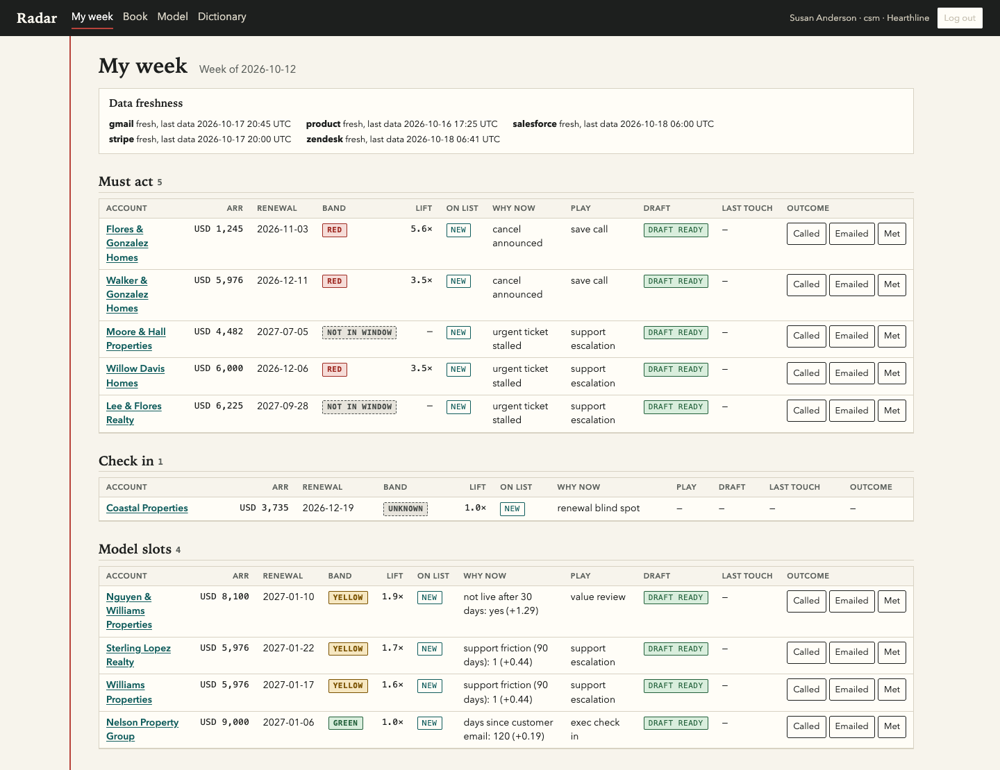
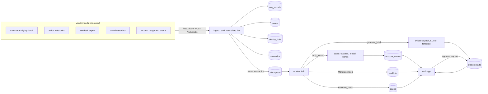
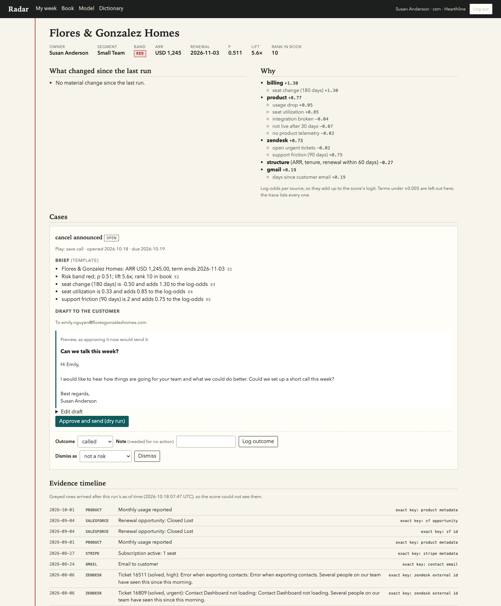
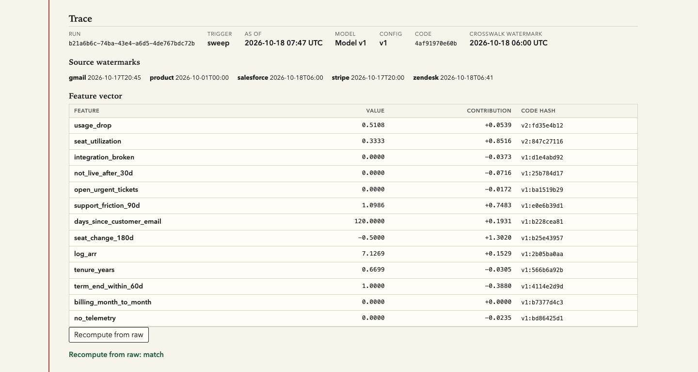
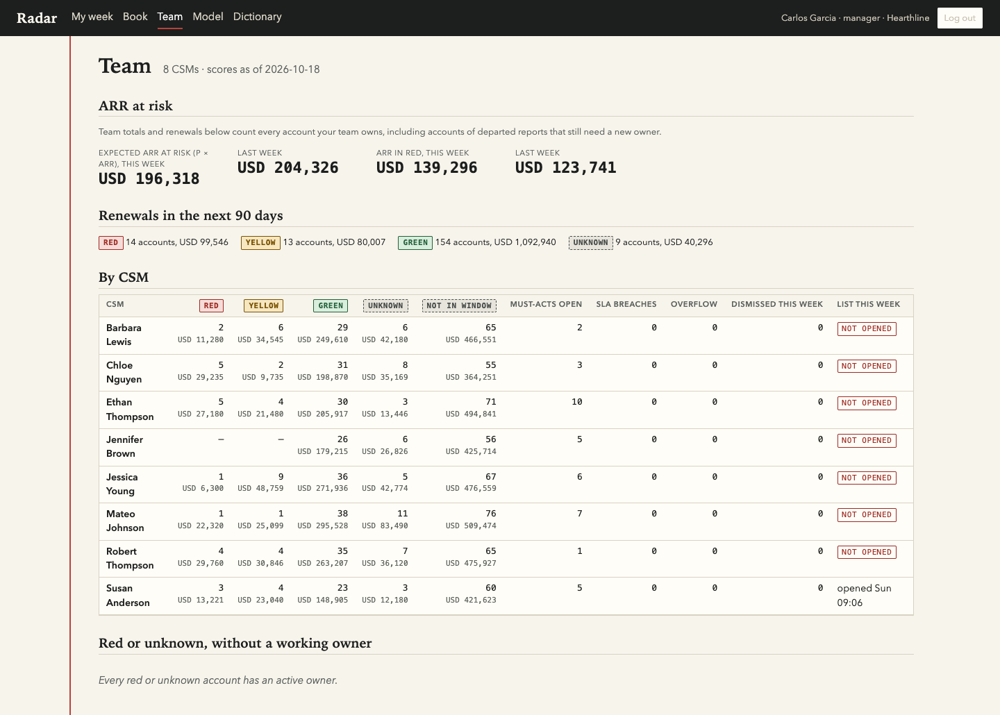
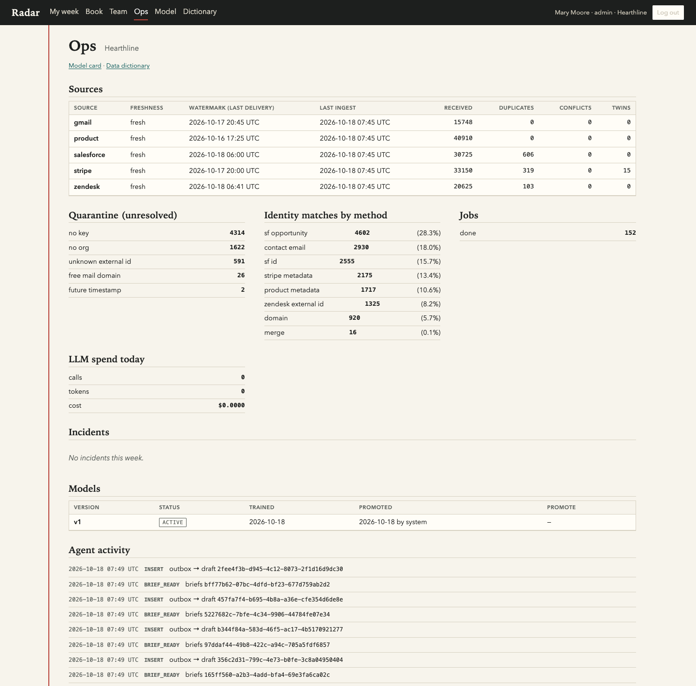
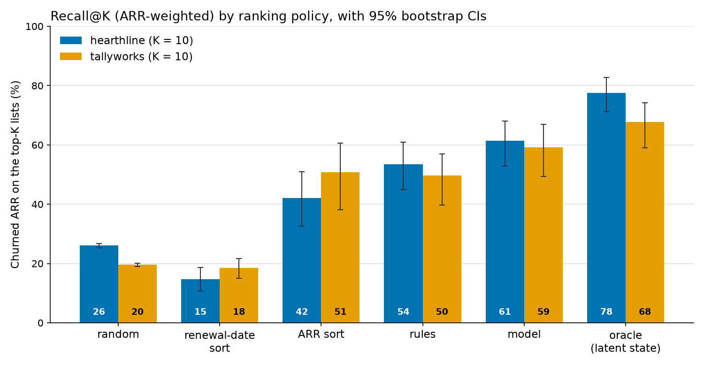

# Radar

Radar gives each customer success manager (CSM) a short weekly list of accounts to act on,
ranked by a model fitted on their own company's data, with the evidence and a draft email
for each. It runs for several customer organisations at once, keeps them apart in the
database, and an unattended agent keeps the lists and cases current.

All data here is synthetic and generated by this repository. The numbers below come from the
generated world, not from a real customer.

- [The Monday moment](#the-monday-moment)
- [Where we disagreed with the request](#where-we-disagreed-with-the-request)
- [Live demo](#live-demo)
- [Quick start](#quick-start)
- [Architecture](#architecture)
- [Decisions](#decisions)
- [Claims and their proof](#claims-and-their-proof)
- [Evaluation](#evaluation)
- [What we skipped, and what comes next](#what-we-skipped-and-what-comes-next)
- [What breaks first at 10x](#what-breaks-first-at-10x)
- [Personal data](#personal-data)
- [OWASP Top 10 for LLM applications](#owasp-top-10-for-llm-applications-2025)
- [The synthetic world](#the-synthetic-world)
- [Limitations](#limitations)
- [Further reading](#further-reading)

## The Monday moment

A CSM owns about 110 accounts (measured: 110.6 active per hearthline CSM) and has room for
about ten proactive conversations a week. On Monday morning they open **My week** and see a
list frozen by the 06:00 sweep:

1. every open must-act case first (a cancellation announced, retries exhausted, a champion's
   email bouncing, an urgent ticket stalled);
2. up to two check-ins for renewals Radar knows little about;
3. the rest of the ten slots, ranked by expected ARR at risk (p x ARR).

The list does not re-sort during the week. A must-act case that opens after Monday (a
cancellation announced on Tuesday) is added at the end of its owner's list with a "new since
Monday" chip, shown after Monday's must-acts; past ten it counts as overflow on the team page.
If that account is already on the list as a model slot or check-in, its row becomes the
must-act in place, with the chip, and keeps its position.

Each row says why now, the play, whether a draft is ready, and takes a one-click outcome. The
account page shows what changed since the last run, the evidence, the trace back to the
stored inputs, and a draft email. Nothing reaches a customer without a person approving it,
and the transport is a dry run: the deploy has no SMTP credentials.



## Where we disagreed with the request

The VP asked for a red/yellow/green dashboard and automatic email to red accounts. The full
argument is in the one-page brief, [docs/brief.md](docs/brief.md), written before any code.

- **No automatic email on red.** The system drafts, a CSM approves. A wrong email to a
  customer with an angry open ticket cannot be taken back.
- **A ranked weekly list sized to capacity, not a traffic-light dashboard.** A CSM with 30
  reds still does not know who to call first.
- **Red, yellow and green stay, as display only.** Every account has a band with a fixed
  meaning (red: lift >= 3 or an open must-act); the band drives no action.

## Live demo

`<LIVE_URL>`

1. Open the URL and enter the demo passcode. The passcode comes with the submission. It is
   not in this repository.
2. Pick a demo user. The picker lists every tenant's users with their role.

| tenant | what it sells | role | example user |
|---|---|---|---|
| Hearthline | real-estate team platform (USD) | CSM | Susan Anderson |
| | | manager | Carlos Garcia |
| | | admin | Mary Moore |
| Tallyworks | SMB accounting (GBP) | CSM | Arjun Robinson |
| | | manager | Patricia Thomas |
| | | admin | Karen Young |
| Kitewire | developer tooling, new this year, no model yet (USD) | CSM | John Green |
| | | manager | Omar Rodriguez |
| | | admin | Noah Nguyen |

A CSM lands on `/week`, and `/book` lists their whole book. Managers and admins also have
`/team`; admins also have `/ops`. Everyone can open `/model` (the model card) and
`/dictionary` (the data dictionary).

## Quick start

You need PostgreSQL 16 on `localhost:54329` (user `postgres`, password `postgres`) and
[uv](https://docs.astral.sh/uv/). Python 3.12 comes through uv.

```sh
PGPASSWORD=postgres createdb -h localhost -p 54329 -U postgres radar  # once
cp .env.example .env && set -a && . ./.env && set +a  # local defaults; read the comments
uv sync --extra ml                                     # ml: scikit-learn and pyarrow
uv run radar bootstrap   # generate the world, replay it, train, score, freeze, draft
uv run radar web         # http://127.0.0.1:8000, log in with RADAR_DEMO_PASSCODE
uv run radar worker      # the unattended agent, in a second shell
```

`radar bootstrap` is idempotent; on an empty database it took 374 s on an Apple M4
([docs/measurements.md](docs/measurements.md)). The variables it reads are in
[.env.example](.env.example): `RADAR_OWNER_DSN` (migrations and bootstrap only), the two
app-role passwords, `RADAR_SECRET_KEY`, `RADAR_DEMO_PASSCODE`, and an optional
`ANTHROPIC_API_KEY` (without one, every brief uses the deterministic template).

The alternative is `docker compose up --build`: Postgres 16, a one-shot bootstrap, the web
app and a long-lived worker, on http://localhost:8000.

Tests run against the same Postgres; each test session creates and drops its own database:

```sh
uv run pytest -q       # the full suite, slow world tests included
uv run ruff check .
```

Deployment (Vercel + Neon Free, or any always-on host) is in [docs/deploy.md](docs/deploy.md).

## Architecture



One Postgres 16 holds everything. Every tenant table has row-level security forced on, and
the web app and worker connect as roles that RLS binds (`radar_web`, `radar_worker`:
NOSUPERUSER, NOBYPASSRLS, own nothing). The worker is a stateless `tick()`: on Vercel a
GitHub Actions schedule calls `POST /internal/tick` every 15 minutes (with a daily Vercel
cron as a backstop); under Docker `radar worker` polls every second.

**Two clocks.** Every record carries `occurred_at` (when it happened in the source) and
`available_at` (when Radar could first have known it: the feed's delivery time in replay,
server time on the webhook path, never a client value). A record is visible at time T only
if both are <= T. Training, scoring, the evidence pack and the trace all use that one rule
(`visible` in `radar/asof.py`), so a feature at T never reads a record that arrived after T.
Identity links follow the same rule, so a late Salesforce record attributes late, as it
would have in history. Events never store an account id; attribution goes through the
links, so re-attribution never rewrites history. Design: [docs/design.md](docs/design.md)
sections 2 and 4.

## Decisions

One line each; the full log, with alternatives and the cost of being wrong, is
[docs/decisions.md](docs/decisions.md).

| decision | why |
|---|---|
| Two clocks on every record, one as-of rule ([design 2](docs/design.md#2-vocabulary-and-clocks)) | a training feature must not read data that arrived after its snapshot |
| Immutable raw ledger, append-only events ([design 4.1](docs/design.md#41-layers)) | replays are idempotent and any score can be recomputed from what was stored |
| Exact-key identity only, the rest to quarantine with a reason ([design 4.2](docs/design.md#42-identity-resolution-order-deterministic-exact-keys-only)) | a wrong match puts one customer's ticket in another customer's email; a missing match is visible |
| Label: a churn decision within 90 days, not the subscription end ([design 5.2](docs/design.md#52-other-canonical-metrics)) | the decision comes weeks before the end; predicting the end is predicting the past |
| One registry of definitions with a code hash per feature ([design 5](docs/design.md#5-canonical-definitions-the-data-dictionary)) | the scorer refuses a model built on other feature code instead of scoring wrong |
| One logistic regression per tenant, stored as JSON ([design 6](docs/design.md#6-model)) | a few hundred decisions per tenant; contributions are exact, so the "why" is the computation |
| Rank by expected ARR at risk (p x ARR), capacity as a cap ([Ruling AZ](docs/decisions.md#a-frozen-weekly-list-per-csm-ranked-by-expected-arr-at-risk-rulings-ap-az-ba)) | the list is the best use of ten touches; a healthy book gets a shorter list |
| Hard facts are rules with an SLA, not model output ([design 5.2](docs/design.md#52-other-canonical-metrics)) | a cancellation notice needs an owner today whatever the model says |
| R/Y/G is display only, with a fixed meaning | a colour that drives nothing cannot cause an email storm |
| A circuit breaker on new cases per tenant per day | an outage or a late batch opens one incident instead of hundreds of cases |
| The job queue is a Postgres table, polled ([design 8](docs/design.md#8-the-agent-unattended)) | jobs are enqueued in the same transaction as the data that triggers them; no second system |
| The LLM writes words only, from a read-only evidence pack, checked by a validator | it never scores, ranks, picks a recipient or a play; a failed check falls back to a template |
| Row-level security forced on every tenant table; app roles cannot bypass it ([design 4.3](docs/design.md#43-tenant-isolation)) | isolation is enforced by the database, not by every query remembering a WHERE clause |
| The runtime never reads `DATABASE_URL` or `PG*` ([Ruling AU](docs/decisions.md#app-roles-that-rls-binds-and-a-startup-check-ruling-au)) | Neon's integration puts owner credentials there; the app refuses owner DSNs |
| Remote bootstrap is a local bootstrap plus `radar push` ([Ruling AT](docs/decisions.md#remote-bootstrap-is-a-local-bootstrap-plus-radar-push-ruling-at)) | replaying record by record over a ~250 ms round trip would take days |

## Claims and their proof

Every test named here runs in CI (`uv run pytest -q`) against a real PostgreSQL 16.

| claim | where it lives | proof |
|---|---|---|
| **We generate the data**: ~5,000 accounts, ~200k records, five sources | `radar/sim/` | 5,000 accounts and 232,305 history records at seed 7 ([measurements](docs/measurements.md#full-world-per-tenant)); `tests/test_sim_feed.py::test_full_scale_volume`, `tests/test_sim_world.py::test_full_scale_volume_estimate` |
| **Messy and out of order** | `radar/sim/delivery.py`, `radar/ingest/` | `tests/test_sim_feed.py::test_messiness_is_planted`; `tests/test_ingest.py::test_shuffled_duplicated_replay_is_identical`; `tests/test_ingest.py::test_out_of_order_subscription_terminal_state_wins`; `tests/test_identity.py::test_late_salesforce_account_resolves_quarantined_ticket` |
| **A model fitted on the data ranks accounts**, not an LLM | `radar/model.py`, `radar/scoring.py` | `tests/test_model.py::test_json_predict_matches_sklearn`; `tests/test_evaluate.py::test_model_beats_random_and_signs_pass`; [model card](docs/model-card-hearthline.md) |
| No feature reads the future | `radar/asof.py`, `radar/features.py` | `tests/test_point_in_time.py::test_as_of_invariance`; `tests/test_point_in_time.py::test_truncation_equivalence`; the naive current-state row in each model card (AUC 0.981 vs 0.767) |
| **It runs without a human** | `radar/agent/worker.py`, `.github/workflows/tick.yml` | `tests/test_worker.py::test_feed_tick_delivers_and_triggers_rule_case_and_brief`; `tests/test_worker.py::test_sweep_runs_once_per_period`; `tests/test_worker.py::test_monday_sweep_freezes_worklists_and_digests`; a 7-day soak (`scripts/soak.py`): 2,938 jobs, 0 dead ([measurements](docs/measurements.md#unattended-soak)); `/ops` agent activity |
| **Multiple customer organisations**, isolated by the database | `radar/migrations/`, `radar/db.py` | `tests/test_isolation.py::test_every_tenant_table_has_forced_rls_and_policy`; `tests/test_isolation.py::test_tenant_a_cannot_read_tenant_b`; `tests/test_isolation.py::test_cross_tenant_fk_rejected`; `tests/test_isolation.py::test_pooled_connection_reuse_does_not_leak`; `tests/test_isolation.py::test_web_and_worker_refuse_a_neon_style_owner`; `tests/test_web.py::test_idor_other_tenant_account_is_404` |
| **Traceable**: what a CSM sees goes back to what was computed | `radar/scoring.py`, account page trace panel | `tests/test_scoring.py::test_score_run_persists_traceable_rows`; `tests/test_scoring.py::test_stored_contributions_sum_to_logit`; `tests/test_scoring.py::test_recompute_check_matches`; `tests/test_web.py::test_account_trace_shows_run_model_watermarks_and_recompute_ok`; `tests/test_web.py::test_timeline_greys_late_records_and_badges_heuristic_matches` |
| **Nothing slips**: every hard fact gets an owner, a due date and an escalation | `radar/policy.py`, `radar/agent/handlers.py` | `tests/test_policy.py::test_worklist_must_acts_first_then_checkins_then_model_slots_capped`; `tests/test_policy.py::test_overflow_flagged_when_must_acts_exceed_k`; `tests/test_worker.py::test_sla_escalation_fires_exactly_once`; `tests/test_worker.py::test_unowned_overdue_case_goes_to_the_admin_digest`; `tests/test_web.py::test_team_page_lists_risky_accounts_without_a_working_owner`; `tests/test_policy.py::test_unknown_never_green` |
| No email reaches a customer without a person | `radar/agent/brief.py` | `tests/test_outbox.py::test_no_send_without_approval`; `tests/test_outbox.py::test_recipient_chosen_by_code_excludes_bounced_and_departed` |
| An outage does not become an alert storm | `radar/policy.py` | `tests/test_policy.py::test_outage_week_replay_caps_new_cases_per_csm`; `tests/test_policy.py::test_breaker_holds_cases_and_opens_one_incident` |
| A prompt injection in a ticket changes nothing | `radar/agent/` | `tests/test_brief.py::test_injection_fixture_does_not_change_score_or_draft`; `tests/test_brief.py::test_validator_catches_mutations` |

The account page shows what changed, why (contributions by source), the evidence timeline
(records that arrived after the run are greyed; each carries how it was matched) and the
trace: run, model version, feature hashes, watermarks, the feature vector, and a "Recompute
from raw" button that rebuilds the features and p from the stored events and compares.





The manager's team page is the VP's dashboard: bands and ARR per CSM, open must-acts, SLA
breaches, overflow, dismissals, whether each list was opened, and red or unknown accounts
without a working owner. The admin's ops page shows source freshness, quarantine by reason,
identity matches by method, jobs, LLM spend, incidents, models and the agent's activity.





## Evaluation

How the model was tested: rolling-origin backtests on Monday snapshots, 4 origins 8 weeks
apart over the last 32 weeks with settled labels. Each origin refits, as training deploys the
model (Platt step included), on snapshots whose labels had settled by the origin (at least
127 days older: the 90-day horizon, the 30-day reactivation check and 7 days of delivery
lag) and scores the next 8 weeks. The recall gate is checked on the latest origin.
The headline is **recall@K**: the share of churned ARR that sat on each CSM's list of up to
K = 10, computed weekly across every book and averaged over test weeks. Intervals are a
paired cluster bootstrap over accounts (1,000 resamples). Kitewire has no model; it is off by
config (`has_model=False`) and runs on the rules heuristic. Full detail:
[model card, hearthline](docs/model-card-hearthline.md) and
[model card, tallyworks](docs/model-card-tallyworks.md); numbers from `eval/*.json` and
[docs/measurements.md](docs/measurements.md#evaluation).



| policy | hearthline recall@K (95% CI) | tallyworks recall@K (95% CI) |
|---|---|---|
| random | 26.1% (25.3 to 26.8) | 19.5% (19.0 to 20.1) |
| renewal-date sort | 14.7% (10.7 to 18.7) | 18.4% (15.0 to 21.7) |
| ARR sort | 42.1% (32.6 to 50.9) | 50.7% (38.1 to 60.5) |
| rules heuristic | 53.5% (44.9 to 61.0) | 49.7% (39.8 to 56.9) |
| **model** | **61.6% (53.1 to 68.1)** | **59.6% (49.8 to 67.9)** |
| oracle (sees latent health; not deployable) | 77.7% (71.2 to 82.9) | 67.9% (59.3 to 74.3) |

- Model minus renewal-date sort: +46.8 points (+37.2 to +55.3) for hearthline, +41.1
  (+30.5 to +49.5) for tallyworks. Model minus rules: +8.1 (+3.2 to +13.1) and +9.8
  (+2.1 to +18.2).
- **Why sorting by renewal date does no better than random.** It is worse than random for
  hearthline (14.7%, CI 10.7 to 18.7, against 26.1%) and no better for tallyworks (18.4%,
  CI 15.0 to 21.7, against 19.5%). Contract accounts decide 30 to 75 days before the term
  end. By the time an account is near renewal, a churner has usually announced it: its
  decision is visible, so it leaves the scored population (live, it becomes a must-act
  case). The accounts left near renewal are mostly renewers.
- **Leakage check.** The same model on today's Salesforce row in every snapshot (a naive
  current-state build) reaches AUC 0.981 for hearthline against 0.767 point in time. The gap
  is what the as-of rule prevents. Unforecastable causes (acquired, business closed, ...)
  sit near random, as they should: pooled, 14% against 25% random for hearthline and 16%
  against 20% for tallyworks. Single causes have 3 to 8 decisions and are noisy.
- **The VP's two lost renewals** (planted in hearthline): the model had Crestline Realty
  Group in its CSM's top 10 from 12 weeks before the decision, against 2 weeks under
  renewal-date sort; Bayside Home Partners 11 weeks against 1.
- **Lead time.** Hearthline: 124 of 190 decisions flagged (on the list two weeks running,
  within the decision's 90-day window), median 11.4 weeks ahead. Tallyworks: 65 of 174,
  median 11.2 weeks.
- **The cost of ranking by ARR at risk.** Ranking by p x ARR catches more churned ARR but
  flags fewer small churners early. Measured before the label-window and settled-label
  fixes, tallyworks flagged 90 of 174 decisions ahead under the earlier floor on p alone and
  70 of 174 under the floor on the ranking key, while recall@K went from 42.6% to 59.1%. Small high-risk accounts are still covered by the must-act rules and
  show on the Book page.

## What we skipped, and what comes next

Skipped on purpose ([design 13](docs/design.md#13-deliberately-skipped)):

- real vendor OAuth and webhooks (the feed simulator calls the same ingestion entrypoint);
- real email sending (the transport is a dry run, and the deploy has no SMTP credentials);
- reading Gmail bodies (headers only);
- fuzzy identity matching;
- uplift modelling (worklist items and case outcomes are logged, so it becomes possible);
- scheduled retraining and automatic promotion (an admin promotes a candidate after seeing how many bands it changes);
- an LLM judge, an MCP server, SSO, a JavaScript front end;
- several currencies inside one tenant;
- table partitioning and cold storage.

Next, in order:

1. Load events into columns instead of a list of dicts, and scope `evaluate_rules` to the one
   account it checks. This is the memory fix that 10x needs first (below).
2. Pass the tick's deadline down to each job, so a long job never starts late in a tick.
3. Run the six-week pilot from the brief: three CSMs and a manager, measured on cases handled
   on time and on surprise churn (lost ARR that never appeared on its owner's list).
4. Retrain with exposure: once CSMs act on the list, saved accounts become negatives. Hold
   out the accounts just below the capacity line as a comparison group.
5. Partition `raw_records` and `events` by month and move old months to cold storage.

## What breaks first at 10x

Measured at 1x and on 10x feature frames tiled from hearthline's 1x frames; database-level
10x numbers are projected from 1x, because a loaded 10x world (about 5.7 GB) did not fit the
build machine's disk. Every number is from
[docs/measurements.md](docs/measurements.md#what-breaks-first-at-10x).

| order | what breaks | measured | fix |
|---|---|---|---|
| 1 | Neon Free storage (1 GB), at about 1.7x | 584.4 MB after bootstrap at 1x; about 5.4 MB a day of growth, 4.6 MB of it score rows; about 5.7 GB at 10x | run `radar prune` on a schedule; drop `feed_buffer` once delivered; at 10x a paid tier and monthly partitions of `raw_records` and `events` |
| 2 | Worker memory on Vercel (2 GB on Hobby), at about 2.9x hearthline | `load_frames` peaks at 5.0 KB per event (780 MiB for hearthline's 139,487 events); about 6,900 MiB at 10x | read events straight into columns (the DataFrame itself is 0.6 KB per event), select only rows visible at T, scope `evaluate_rules` to its account |
| 3 | A job that starts late in a tick | the tick budget is 240 s inside a 300 s function, so a late job gets at most 60 s | pass the deadline into `tick()` and skip a job whose recent p95 exceeds the time left |
| 4 | Rule checks | 262 checks a week at 0.95 s each at 1x; about 6.9 of the 44.8 worker hours a week at 10x | the same as row 2 |
| 5 | The daily sweep does not break | 3.0 s for hearthline at 1x; about 30 s projected at 10x | needs the memory fix in row 2 |
| 6 | Page queries slow down linearly | the account timeline sorts the tenant's 16,240 identity links (10.9 ms warm) | start the timeline from the account's refs, as the brief query does; index `worklist_items` and `cases` by account |
| 7 | Bootstrap replay | 953 records/s for hearthline; at least 1,450 s at 10x | bulk-load raw records with COPY |

Brief generation no longer grows with the world: the evidence query went from 3.7 s per
hearthline brief to about 1 ms (migration 008). LLM spend in a correlated shock is
capped by config, not measured (the key had no credit): each tenant has a daily budget of
200,000 tokens, which bounds spend at $0.40 a day for three tenants on Haiku 5.5.

## Personal data

All of it is synthetic here; the table is what a real deployment would hold. "The CSM" means
the account's owner; their manager and the tenant's admin see what the CSM sees. Row-level
security keeps every row inside its tenant.

| field | source | where stored | who can see it | what reaches the LLM | retention |
|---|---|---|---|---|---|
| Contact name, email, title | Salesforce Contact | `raw_records`, `events`, `contacts` | the draft's recipient address, on the account page | nothing: the LLM is told to write "Hi there"; the template draft has a `{first_name}` placeholder that code fills in the preview and on approval | life of the database |
| Customer email addresses | Gmail headers (From, To, Cc) | `raw_records`, `events` | nobody in the app; the timeline says "Email from customer" | nothing | life of the database |
| Email subject | Gmail headers | `raw_records` only | nobody in the app | nothing | life of the database |
| Email bodies | not collected | | | | |
| Ticket subject and description | Zendesk | `raw_records` in full; `events` cut to 200 and 500 characters | the CSM, in the timeline, with email addresses, URLs and phone numbers redacted | the same redacted text, cut to 280 characters and tagged untrusted | life of the database |
| Billing contact email and name | Stripe customer | `raw_records`, `events` | nobody in the app | nothing | life of the database |
| Account name, segment, domain | Salesforce Account | `accounts`, `events` | everyone in the tenant with the account in scope | name and segment | life of the database |
| Staff name and email | seeded users | `users` | the login picker (anyone with the passcode); digests | nothing: code fills the sender's name | life of the database |
| Bounce status | Gmail DSN | `events`, `contacts.hard_bounced_at` | the CSM ("An email to a contact bounced: 5.1.1") | that display string | life of the database |

There is no retention job yet: `radar prune` deletes only old score rows, and delivered feed
lines leave `feed_buffer`. Erasure for a data-subject request would mean deleting contact rows
and redacting raw payloads through the owner role; it is not built.

## OWASP Top 10 for LLM applications (2025)

| risk | our control | test |
|---|---|---|
| LLM01 Prompt injection | ticket text reaches the model only inside a `tool_result`, tagged untrusted; the model has no tools that act (`tool_choice` none); a deterministic validator checks every output | `tests/test_brief.py::test_injection_fixture_does_not_change_score_or_draft` |
| LLM02 Sensitive information disclosure | the pack carries no contact data; ticket text is redacted; a customer email may cite only items matched by an exact key to this account | `tests/test_brief.py::test_email_may_cite_only_customer_safe_items`; `tests/test_brief.py::test_relinked_ref_is_not_customer_safe` |
| LLM03 Supply chain | `uv.lock` with `uv sync --locked` in CI; GitHub Actions pinned by commit SHA; gitleaks on every push; the model id is pinned in config | CI (`.github/workflows/ci.yml`) |
| LLM04 Data and model poisoning | the risk model never reads LLM output or ticket text; banned inputs are listed in the registry | `tests/test_features.py::test_banned_inputs_not_in_features`; the injection test above (score unchanged) |
| LLM05 Improper output handling | Jinja autoescape on, no `safe` filter on database or LLM text, a CSP header, plain-text drafts; the validator rejects URLs, emails, phones and HTML in the email | `tests/test_web.py::test_ticket_html_is_escaped`; `tests/test_web.py::test_csp_header_present`; `tests/test_brief.py::test_validator_catches_mutations` |
| LLM06 Excessive agency | the LLM never scores, ranks, picks a recipient or a play; email is only a draft until a person approves; the transport is a dry run | `tests/test_outbox.py::test_no_send_without_approval`; `tests/test_outbox.py::test_recipient_chosen_by_code_excludes_bounced_and_departed` |
| LLM07 System prompt leakage | the system prompt holds rules only, no secrets or data; leaking it reveals nothing | none needed |
| LLM08 Vector and embedding weaknesses | not applicable: no retrieval, no embeddings | none |
| LLM09 Misinformation | every summary point cites evidence ids; every number must appear in the cited display strings; a person reads every draft | `tests/test_brief.py::test_validator_catches_mutations`; `tests/test_brief.py::test_template_passes_the_validator` |
| LLM10 Unbounded consumption | one attempt plus one retry, `max_tokens` 4,096, a per-tenant daily token budget, briefs only for must-acts and frozen slots, cached by evidence hash | `tests/test_brief.py::test_token_budget_exhausted_uses_template`; `tests/test_brief.py::test_brief_generated_once_under_retry` |

## The synthetic world

`radar sim generate --seed 7` builds three tenants: hearthline (2,600 accounts, 16 CSMs, a
real-estate team platform in USD), tallyworks (2,000 accounts, 12 CSMs, SMB accounting in
GBP) and kitewire (400 accounts, 3 CSMs, developer tooling onboarded in 2026, no model).
Each account has a latent health that moves forward week by week; shocks push it down or
up, and churn decisions are drawn from it, so signals come before outcomes because of the
process ([design 3.2](docs/design.md#32-world-model-strictly-forward-weekly)). About 11 to 18%
of voluntary churn is drawn independently of health, so no model can catch it. The world is
hard on purpose: a test keeps the oracle's AUC between 0.80 and 0.92 and no single feature
above 0.72 (`tests/test_diagnostics.py::test_oracle_auc_in_band`).

**The feed ends on 2027-04-30** (`sim_end`). History up to 2026-10-17 is replayed at
bootstrap; the rest is delivered by the agent as its time comes, so a reviewer sees new data
arrive. Late deliveries run past the end date: the last product batch lands on 2027-05-06.

The VP's two lost renewals are planted in hearthline (Crestline Realty Group and Bayside Home
Partners): an integration break that is never repaired, a champion leaving and a bug episode,
injected 16 to 18 weeks before their term end, and the CSM's outbound email stopped for 60
days. Their churn decision is forced to match the story; their signals are still generated
forward from the shocks. Maple Street Realty carries a prompt-injection ticket.

The main knobs of the generator, printed from [radar/sim/params.py](radar/sim/params.py) by
`uv run python scripts/params_table.py` (a test checks this table matches):

| knob | value | meaning |
|---|---|---|
| `sim_start` | 2022-02-28 | first simulated week (a Monday) |
| `latent.phi` | 0.92 | weekly persistence of latent health h |
| `latent.sigma` | 0.25 | weekly noise on h |
| `latent.mu_mean` | 0.3 | mean of each account's long-run health |
| `latent.mu_sd` | 0.6 | spread of long-run health across accounts |
| `onboarding.ramp_weeks` | 8 | weeks for a new account's health to ramp up |
| `onboarding.fail_rate` | 0.15 | share of accounts that fail onboarding |
| `onboarding.fail_offset` | -1.0 | health offset for a failed onboarding |
| `shocks.champion_departure.rate` | 0.15 | annual rate: the champion leaves |
| `shocks.champion_departure.effect` | -1.0 | health effect of a champion leaving |
| `shocks.integration_break.rate` | 0.1 | annual rate: the CRM integration breaks |
| `shocks.integration_break.repair_share` | 0.4 | share of breaks that get repaired |
| `shocks.budget_cut.rate` | 0.12 | annual rate: budget cut, seats cut |
| `shocks.budget_cut.seat_cut` | 0.3 | share of seats removed by a budget cut |
| `shocks.competitor_eval.rate` | 0.1 | annual rate: a slow slide during a competitor trial |
| `shocks.competitor_eval.drift` | -0.05 | health drift per week while evaluating |
| `shocks.bug_episode.rate` | 0.2 | annual rate: a product bug episode with urgent tickets |
| `shocks.expansion.rate` | 0.15 | annual rate: expansion, seats added |
| `outage.hearthline` | 2025-11-10 | hearthline's tenant-wide outage week |
| `outage.tallyworks` | 2026-03-02 | tallyworks' tenant-wide outage week |
| `outage.account_share` | 0.3 | share of accounts that file outage tickets |
| `churn.hearthline.annual` | (-3.3, -2.8) | (alpha, beta): P(churn at renewal) = sigmoid(a + b * mean h) |
| `churn.tallyworks.month_to_month` | (-9.4, -4.5) | (alpha, beta): weekly hazard for month-to-month |
| `notice_days` | (30, 75) | days before term end that a contract account decides |
| `unforecastable.rate` | hearthline 0.026, tallyworks 0.03, kitewire 0.05 | annual rate of churn drawn independently of health |
| `notice_modes` | stripe_cancel 0.7, no_notice 0.2, cancellation_ticket 0.1 | how a decision first shows up |
| `save_share` | 0.5 | a renewer schedules a cancel, then reverses it, with p = this x P(churn) |
| `loss_reason_noise` | 0.25 | Salesforce loss reason differs from the true cause |
| `payments.fail_monthly` | 0.015 | monthly card payment failure rate |
| `payments.recover` | 0.6 | share of failures Smart Retries recovers |
| `telemetry_share` | 0.82 | share of accounts with a product workspace |
| `personal_email_share` | 0.1 | contacts on a personal email domain |
| `merge_share` | 0.01 | accounts that get a duplicate Salesforce record, merged later |
| `tickets.silent_share` | 0.4 | accounts that file fewer tickets of every kind (x 0.3) |
| `email.suppress_days` | 60 | days the CSM's outbound mail stops for the VP's two cases |
| `feed.stripe.metadata` | 0.85 | Stripe customers carrying a Salesforce id |
| `feed.stripe.messy_id` | 0.2 | of those, ids in the short form, lowercase or padded |
| `feed.stripe.tail` | 0.015 | Stripe events delivered late (backoff tail, mean 12 h) |
| `feed.stripe.redeliver` | 0.01 | Stripe events delivered twice with the same id |
| `feed.stripe.twin` | 0.003 | Stripe semantic twins (new id, same state) |
| `feed.zendesk.org_external_id` | 0.7 | Zendesk organisations carrying a Salesforce id |
| `feed.salesforce.reexport` | 0.02 | Salesforce rows exported again unchanged |
| `feed.gmail.date_skew` | 0.05 | Gmail Date headers with a wrong offset |
| `feed.product.sf_account_id` | 0.9 | usage rows carrying a Salesforce id |
| `feed.product.late_batch` | 0.1 | monthly usage batches delivered days late |
| `feed.product.restate` | 0.03 | usage rows restated with a higher version |
| `feed.product.future` | 0.001 | product events with a future timestamp (device clock) |

How "messy and out of order" is planted ([design 3.5](docs/design.md#35-source-payloads-generator-output--ingestion-input)):
each source is written in its vendor's field names and delivery habits, and ingestion has
to cope.

- **Stripe**: webhooks within seconds, but 1.5% arrive on a backoff tail of up to 72 hours;
  1% are delivered twice with the same event id; a few are semantic twins (a new event id,
  the same state); events in the same second are shuffled. The API version changes from
  `2024-06-20` to `2025-03-31.basil` on 2025-06-01, which moves `current_period_end` and the
  invoice's subscription reference. The Salesforce id in customer metadata is missing 15% of
  the time and, when present, sometimes 15 characters, lowercase or padded, or under the key
  `salesforce_id`.
- **Salesforce**: a nightly batch at 02:00 tenant time, so a day late; some rows are exported
  twice; a few duplicate accounts are merged later; test accounts are mixed in.
- **Zendesk**: incremental-export rows, about two versions per ticket, occasional duplicates;
  about 10% of tickets have no organisation, and 30% of organisations carry no Salesforce id.
- **Gmail**: metadata only; `Date` headers with wrong offsets (`internalDate` is the truth);
  the same message in two mailboxes; auto-replies; hard bounces (5.1.1), delays (4.x) and
  policy rejects (5.7.1); personal-domain senders.
- **Product**: a monthly batch on the 3rd, sometimes up to 9 days late; restatements as
  version + 1; a schema change on 2025-09-01 that renames a hearthline field; a few events
  with future timestamps; about 18% of accounts have no workspace at all.

The result at bootstrap: 25,644 quarantine rows, about 11% of records, by design. 14,995
resolved when the missing record arrived (most of them Stripe customers that arrived before
their Salesforce account, resolved a median 0.5 days later). Of the 10,649 left, 6,982 are
usage rows from 385 workspaces that never send a Salesforce id, and 2,631 are tickets with
no organisation; Radar does not guess a match for either.

## Limitations

- **The data is synthetic.** The numbers show that the method works on a world built to be
  hard; they do not say what a real book will do. The planted lost renewals are 2 accounts
  out of about 5,000.
- **The model sees 13 features.** Seat changes carry weak signal (seat_change_180d alone has
  AUC 0.55), and some seat-cut risk shows up as a usage drop.
- **Ranking by ARR at risk flags fewer small churners early.** They are covered by must-act
  rules and the Book page, not by model slots.
- **Calibration is borderline.** Scored as training deploys it (Platt step included), every
  billing segment in the backtest sits just under ECE 0.02 (hearthline 0.020 yearly and
  0.019 monthly; tallyworks 0.020 and 0.017). Platt is fitted and judged on the same latest 8
  matured weeks. The measured database's tallyworks model was trained before Platt had to
  lower the worst segment's error: it carries a pair the current check rejects (yearly ECE
  0.030 to 0.037 on its slice), so a fresh bootstrap deploys it without one.
- **LLM briefs were not exercised at scale**: the API key used for the measurements had no
  credit, so every measured brief is a template. The LLM path is covered by tests with a fake
  client and one opt-in live test (`-m live_llm`).
- **Source freshness** uses fixed per-source hour thresholds; production would set them from
  each source's observed volume. Gmail goes quiet on weekends, so the weekend raises a
  `source_stale` incident.
- **No retention or erasure job** (see Personal data).
- **One Postgres for everything.** Ingestion, scoring, the queue and the pages share it; at 10x
  the order of failures is in the table above.

## Further reading

| document | what it holds |
|---|---|
| [docs/brief.md](docs/brief.md) | the one-page solution brief, written before code |
| [docs/deck/radar.pptx](docs/deck/radar.pptx) | the slide deck |
| [docs/design.md](docs/design.md) | the technical design, with the schema and event contracts |
| [docs/decisions.md](docs/decisions.md) | the decision log |
| [docs/measurements.md](docs/measurements.md) | every measured number: bootstrap, soak, sizes, 10x |
| [docs/model-card-hearthline.md](docs/model-card-hearthline.md), [docs/model-card-tallyworks.md](docs/model-card-tallyworks.md) | the evaluation, per tenant |
| [docs/data-dictionary.md](docs/data-dictionary.md) | every feature, metric and rule, generated from the registry |
| [docs/deploy.md](docs/deploy.md) | Vercel + Neon, or Docker Compose |
| [docs/research/sources.md](docs/research/sources.md) | the vendor behaviour the generator reproduces, with links |

The images and the deck regenerate from committed scripts: `scripts/screenshots.py --docs`,
`scripts/charts.py` and `scripts/deck.py`.
